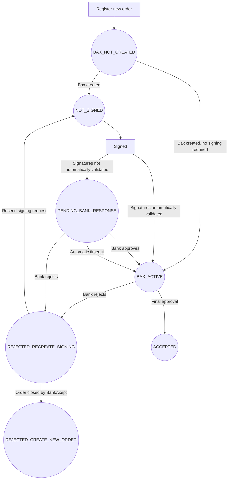

# Introduction

This is an API for Norwegian [PSPs](dictionary.md#psp) to register new [Bax numbers](dictionary.md#bax-number) which are automatically assigned BankAxept products. See the [OpenAPI Spec](https://onboarding.bankaxept.no/swagger-ui/index.html#/) for the full interactive API reference.
Following a merchant agreement registration request BankAxept will:

* Create a Bax number in [Baxbis](dictionary.md#baxbis)
* Create a financial agreement document between the issuing bank and the customer, if needed.
* Create an agreement between BankAxept and the customer, if needed.
* Collect any necessary signature(s) using the signee and contact information provided in the request.

Bax numbers are loaded onto payment terminals in order to connect them to the payment network.
Baxbis is the system operated by Nets which issues Bax numbers and
maintains the network necessary for payment terminals to work.

## Limitations
This API does not support bank accounts that are not owned by the organisation entering into the agreement. For example, Enkeltpersonforetak accounts might be registered on the owners Norwegian national identity number instead of their organisation number. This will cause the [KAR](dictionary.md#kar) check to fail since the account is not connected to the organisation. In these cases the order must go through Nets Ordrekontor.

This API allows for ordering the BankAxept product "return of goods". The number of days in which a good can be returned after sale (the return window) will be set to the default value of 30 days.

If a customer requires a return period longer than 30 days, or if the return applies to chain stores that needs "Chain return of goods", please contact BankAxept Support at bankaxept@stoe.no

## Setting up your Onboarding integration

There are multiple points of configuration that need to be aligned before you can fully utilize the Onboarding API. The necessary steps may be found in our
[Configuration Guide](./configuration.md).

## Possible Order Statuses

| Status                     | Description                                                                                                                                  |
|----------------------------|----------------------------------------------------------------------------------------------------------------------------------------------|
| BAX_NOT_CREATED            | The order has been created in our system but does not yet have an associated [Bax number](dictionary.md#bax-number).                                    |
| NOT_SIGNED                 | The order has not been signed yet.                                                                                                           |
| PENDING_BANK_RESPONSE      | The order has been signed by the customer and is waiting for the bank to approve the signatures.                                             |
| BAX_ACTIVE                 | The order has been activated and is waiting to become ACCEPTED. The bank may still review the signatures, or may already have approved them, in which case this status is only short-lived. |
| REJECTED_RECREATE_SIGNING  | The order has been rejected by the bank. This is not a terminal state and can be moved by calling `PUT /v2/orders/{orderId}/signees`. |
| ACCEPTED                   | The order has received final approval from the bank. This is a terminal state.                                                               |
| REJECTED_CREATE_NEW_ORDER  | The order has been closed by BankAxept. This is a terminal state. A new order needs to be created.                                           |

### Order Statuses Flowchart

For a step-by-step view of the API calls and [webhooks](./webhooks.md) behind each path in this chart, see the flow diagrams for [Production](./prod_flows.md) and [Test](./test_flows.md).

When the bank approves an order in `PENDING_BANK_RESPONSE`, the order passes briefly through `BAX_ACTIVE` before it moves on to `ACCEPTED`. You may see `BAX_ACTIVE` for a short time, including in [webhooks](./webhooks.md), even though the bank has already approved the order.

## Integration Guidelines

We validate the following information when registering an order:

- **Account Ownership**: We validate that the account number belongs to the customer.
- **Account Number**: We validate that the account number is valid and belongs to the customer.
- **MCC**: We validate that the [MCC](dictionary.md#mcc) is valid and supported. You can find a list of supported MCCs in our [MCC documentation](./mcc_codes.md).

### Test
See [Test Data](./test_data.md) for how to discover valid bank identifiers, construct account numbers, select BRREG organisations and signees, and decide whether to bypass account ownership validation. You can view our flow diagrams for the test environment [here](./test_flows.md).

### Production
You can view our flow diagrams for the production environment [here](./prod_flows.md).

## Webhooks
You can view more information about webhooks [here](./webhooks.md).
