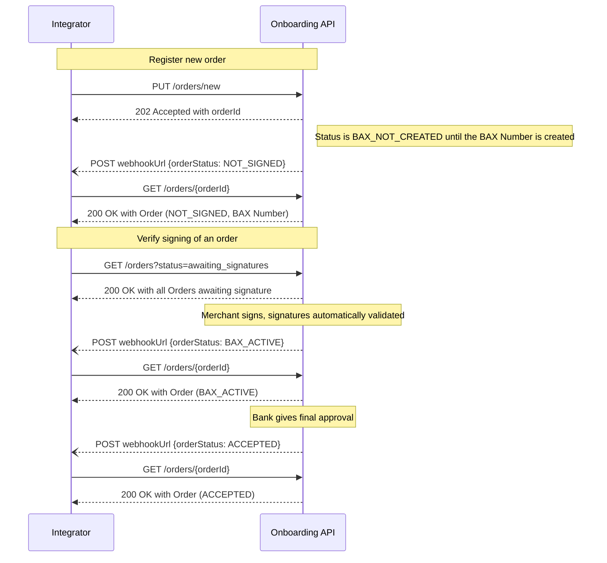
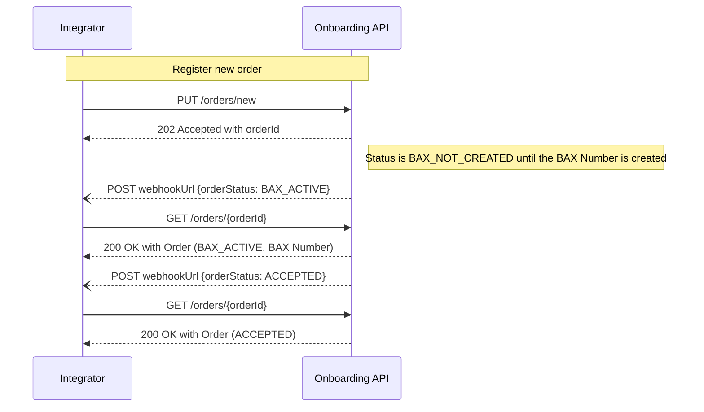

# Valid flows for Production

These diagrams show the API calls and [webhooks](./webhooks.md) for each path through the [Order Statuses Flowchart](./getting_started.md#order-statuses-flowchart).
Webhooks are shown where they are triggered. Delivery order is not guaranteed, see [Webhooks](./webhooks.md#delivery-and-ordering).
If you do not use webhooks, you can poll `GET /psp/v2/orders/{orderId}` instead.

## Automatically Approved Signatures
An order is created with and signed by the correct signee(s) and the signatures are approved


## No Signing Required
An order is created for a customer where no signing is required, and the order is completed without a signing step


## Signatures Approved by Bank
An order is created and signed by signee(s) that cannot be automatically validated, and the bank approves the signatures.
When the bank approves, the order passes briefly through `BAX_ACTIVE` before it moves on to `ACCEPTED`.

=== "Approved within the deadline"

    ```mermaid
    sequenceDiagram
    participant I as Integrator
    participant O as Onboarding API

    note over I, O: Register new order
    I ->> O: PUT /orders/new
    O -->> I: 202 Accepted with orderId

    O --) I: POST webhookUrl {orderStatus: NOT_SIGNED}
    I ->> O : GET /orders/{orderId}
    O -->> I: 200 OK with Order (NOT_SIGNED, BAX Number)

    note over O: Merchant signs, signatures not automatically validated
    O --) I: POST webhookUrl {orderStatus: PENDING_BANK_RESPONSE}
    I ->> O : GET /orders/{orderId}
    O -->> I: 200 OK with Order (PENDING_BANK_RESPONSE)

    note over O: Bank approves
    O --) I: POST webhookUrl {orderStatus: BAX_ACTIVE}
    note right of O: Short intermediate status
    O --) I: POST webhookUrl {orderStatus: ACCEPTED}
    I ->> O : GET /orders/{orderId}
    O -->> I: 200 OK with Order (ACCEPTED)
    ```

=== "Approved after the deadline expires"

    ```mermaid
    sequenceDiagram
    participant I as Integrator
    participant O as Onboarding API

    note over I, O: Register new order
    I ->> O: PUT /orders/new
    O -->> I: 202 Accepted with orderId

    O --) I: POST webhookUrl {orderStatus: NOT_SIGNED}
    I ->> O : GET /orders/{orderId}
    O -->> I: 200 OK with Order (NOT_SIGNED, BAX Number)

    note over O: Merchant signs, signatures not automatically validated
    O --) I: POST webhookUrl {orderStatus: PENDING_BANK_RESPONSE}
    I ->> O : GET /orders/{orderId}
    O -->> I: 200 OK with Order (PENDING_BANK_RESPONSE)

    note over O: Bank deadline expires, the order is activated
    O --) I: POST webhookUrl {orderStatus: BAX_ACTIVE}
    I ->> O : GET /orders/{orderId}
    O -->> I: 200 OK with Order (BAX_ACTIVE)

    note over O: Bank approves later
    O --) I: POST webhookUrl {orderStatus: ACCEPTED}
    I ->> O : GET /orders/{orderId}
    O -->> I: 200 OK with Order (ACCEPTED)
    ```

## Signatures Rejected by Bank
An order is created and signed by the incorrect signee(s), and the signatures are rejected by the bank.

=== "Rejected within the deadline"

    ```mermaid
    sequenceDiagram
    participant I as Integrator
    participant O as Onboarding API

    note over I, O: Register new order
    I ->> O: PUT /orders/new
    O -->> I: 202 Accepted with orderId

    O --) I: POST webhookUrl {orderStatus: NOT_SIGNED}
    I ->> O : GET /orders/{orderId}
    O -->> I: 200 OK with Order (NOT_SIGNED, BAX Number)

    note over O: Merchant signs, signatures not automatically validated
    O --) I: POST webhookUrl {orderStatus: PENDING_BANK_RESPONSE}
    I ->> O : GET /orders/{orderId}
    O -->> I: 200 OK with Order (PENDING_BANK_RESPONSE)

    note over O: Bank rejects
    O --) I: POST webhookUrl {orderStatus: REJECTED_RECREATE_SIGNING}
    I ->> O : GET /orders/{orderId}
    O -->> I: 200 OK with Order (REJECTED_RECREATE_SIGNING and reason for rejection)
    ```

=== "Rejected after the deadline expires"

    ```mermaid
    sequenceDiagram
    participant I as Integrator
    participant O as Onboarding API

    note over I, O: Register new order
    I ->> O: PUT /orders/new
    O -->> I: 202 Accepted with orderId

    O --) I: POST webhookUrl {orderStatus: NOT_SIGNED}
    I ->> O : GET /orders/{orderId}
    O -->> I: 200 OK with Order (NOT_SIGNED, BAX Number)

    note over O: Merchant signs, signatures not automatically validated
    O --) I: POST webhookUrl {orderStatus: PENDING_BANK_RESPONSE}
    I ->> O : GET /orders/{orderId}
    O -->> I: 200 OK with Order (PENDING_BANK_RESPONSE)

    note over O: Bank deadline expires, the order is activated
    O --) I: POST webhookUrl {orderStatus: BAX_ACTIVE}
    I ->> O : GET /orders/{orderId}
    O -->> I: 200 OK with Order (BAX_ACTIVE)

    note over O: Bank rejects later
    O --) I: POST webhookUrl {orderStatus: REJECTED_RECREATE_SIGNING}
    I ->> O : GET /orders/{orderId}
    O -->> I: 200 OK with Order (REJECTED_RECREATE_SIGNING and reason for rejection)
    ```

=== "Rejected after automatic validation"

    ```mermaid
    sequenceDiagram
    participant I as Integrator
    participant O as Onboarding API

    note over I, O: Register new order
    I ->> O: PUT /orders/new
    O -->> I: 202 Accepted with orderId

    O --) I: POST webhookUrl {orderStatus: NOT_SIGNED}
    I ->> O : GET /orders/{orderId}
    O -->> I: 200 OK with Order (NOT_SIGNED, BAX Number)

    note over O: Merchant signs, signatures automatically validated
    O --) I: POST webhookUrl {orderStatus: BAX_ACTIVE}
    I ->> O : GET /orders/{orderId}
    O -->> I: 200 OK with Order (BAX_ACTIVE)

    note over O: Bank rejects later
    O --) I: POST webhookUrl {orderStatus: REJECTED_RECREATE_SIGNING}
    I ->> O : GET /orders/{orderId}
    O -->> I: 200 OK with Order (REJECTED_RECREATE_SIGNING and reason for rejection)
    ```

### After a rejection
An order in `REJECTED_RECREATE_SIGNING` is not final. It continues in one of two ways:

- **Resend signing request:** use this if signing requirements change or if the previous signature was rejected. The order goes back to `NOT_SIGNED` and continues as in the flows above.
- **Order closed by BankAxept:** the order moves to `REJECTED_CREATE_NEW_ORDER`. This is a terminal state, and a new order needs to be created.

=== "Resend signing request"

    ```mermaid
    sequenceDiagram
    participant I as Integrator
    participant O as Onboarding API

    I ->> O: PUT /orders/{orderId}/signees
    O -->> I: 202 Accepted
    O ->> O: Send email to customer
    O --) I: POST webhookUrl {orderStatus: NOT_SIGNED}
    I ->> O : GET /orders/{orderId}
    O -->> I: 200 OK with Order (NOT_SIGNED)
    ```

=== "Order closed by BankAxept"

    ```mermaid
    sequenceDiagram
    participant I as Integrator
    participant O as Onboarding API

    note over O: Order closed by BankAxept
    O --) I: POST webhookUrl {orderStatus: REJECTED_CREATE_NEW_ORDER}
    I ->> O : GET /orders/{orderId}
    O -->> I: 200 OK with Order (REJECTED_CREATE_NEW_ORDER)
    ```
