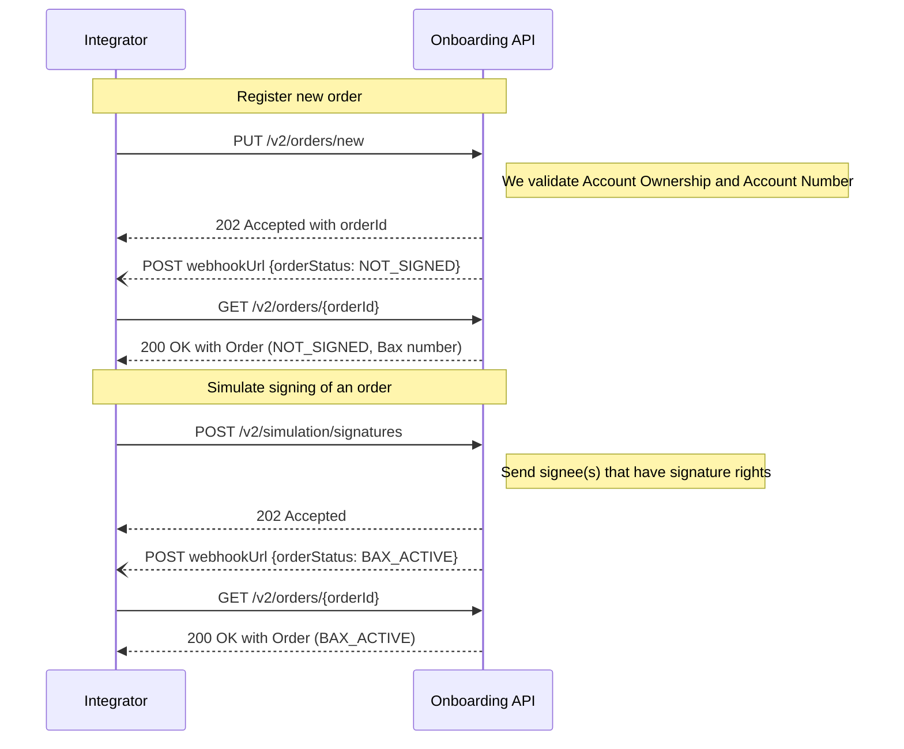
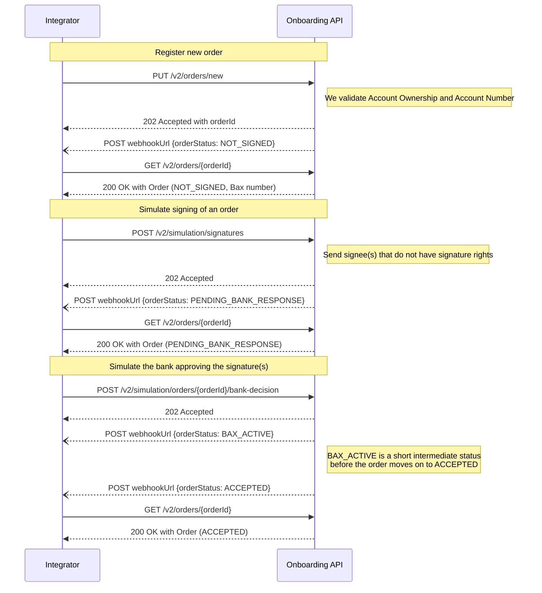
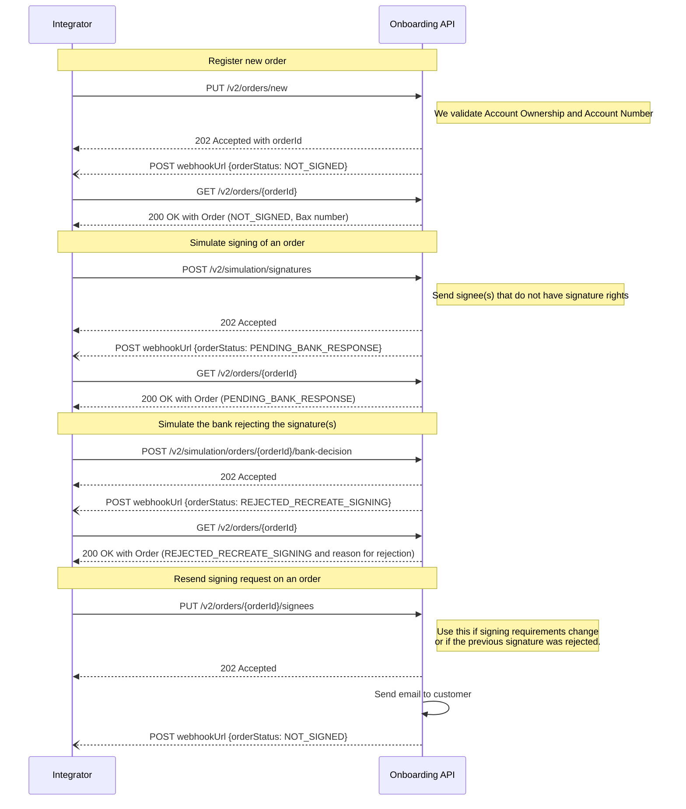

# Test flows

These diagrams show the API calls and [webhooks](./webhooks.md) for the main paths through the [Order Statuses Flowchart](./index.md#order-statuses-flowchart), using the simulation endpoints available in the test environment.
The remaining paths (for example bank deadline expiry or an order closed by BankAxept) behave as described in the [Production flows](./prod_flows.md).
Webhooks are shown where they are triggered. Delivery order is not guaranteed, see [Webhooks](./webhooks.md#delivery-and-ordering).
If you do not use webhooks, you can poll `GET /v2/orders/{orderId}` instead.
For how to construct valid bank identifiers, account numbers, BRREG organisations, and signees, see [Test Data](./test_data.md).

## Automatically Approved Signatures
An order is created with and signed by the correct signee(s) and the signatures are automatically approved. See [Signees](./test_data.md#signees) for how to construct a matching combination.

## Signatures Approved by Bank
An order is created with and signed by signee(s) that cannot be validated based on the info in [BRREG](dictionary.md) and the signatures are automatically rejected but then approved by the bank. See [Signees](./test_data.md#signees) for how BRREG signing combinations work.

## Signatures Rejected by Bank
An order is created with and signed by signee(s) that cannot be validated based on the info in [BRREG](dictionary.md) and the signatures are automatically rejected and later rejected by the bank. See [Signees](./test_data.md#signees) for how BRREG signing combinations work.

